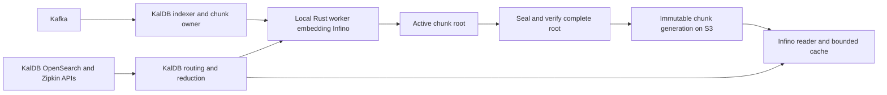

# ADR 0009: Evaluate Replacing Lucene with Infino

## Status

Current state: `Draft`

Date: 2026-11-04

Discussion thread: `n/a`

Issue: `n/a`

PR: `n/a`

Supersedes: `n/a`

Superseded by: `n/a`

**Proposed decision:** Evaluate Infino as KalDB's indexing and query execution
engine through a bounded prototype and a reproducible benchmark. Replace Lucene
only if correctness, reliability, performance, and operating cost meet the gates
below. Lucene remains the production engine while this decision is evaluated.
There are no benchmark results yet; this ADR does not establish that Infino is
better or approve a production migration.

This ADR uses KalDB for the project name; repository packages and documentation
still use Astra. Code references describe checkout
`5f59ddfa8fda09c6467da3ae76c1ba981e7b068c`.

## Motivation

KalDB uses Lucene for indexing, text and scalar filtering, sorting, and the
document iteration used by OpenSearch aggregations. We want to determine whether
Infino can reduce ingestion cost, query latency, or storage and cache footprint
while retaining KalDB's log and trace search behavior.

Infino combines indexed text retrieval and SQL over Parquet. That could improve
filtered analytical queries and make stored data accessible to Parquet tooling.
These are hypotheses to test against KalDB's workload. KalDB already separates
compute from object storage and supports Lucene S3 streaming through
`AstraSearcherManager` and `S3RemoteDirectory`; object storage alone is not a new
benefit of switching engines.

### What Infino provides, and what remains unproven

The candidate is [infino-ai/infino](https://github.com/infino-ai/infino), not an
assumed Elasticsearch-compatible service. Research is pinned to commit
[`99d0c2d4ba1c3c1bf03174819db878f6311988b2`](https://github.com/infino-ai/infino/tree/99d0c2d4ba1c3c1bf03174819db878f6311988b2),
whose [Cargo manifest](https://github.com/infino-ai/infino/blob/99d0c2d4ba1c3c1bf03174819db878f6311988b2/Cargo.toml)
declares engine version `0.11.24`, Apache-2.0 licensing, and Rust `1.95`.
Revalidate the pin before implementing; do not benchmark a moving branch.

| Area | Evidence at the reviewed revision | Implication for KalDB |
| --- | --- | --- |
| Integration | Embedded Rust engine; published Rust, Python, and Node surfaces; no Java binding identified in the reviewed public API. A hosted remote client path also exists. | A Java integration must be built and measured. A hosted client is not evidence of a supplied self-hosted KalDB sidecar. |
| Storage | Parquet superfiles contain data and per-file indexes. Tables also depend on catalogs, manifests, summaries, term-index objects, and potentially tombstones. | A snapshot cannot consist of Parquet files alone. |
| Retrieval | BM25, unranked token matching, exact-value matching, scalar SQL, and vector/hybrid retrieval. Phrase matching requires positions enabled per column. | There are useful primitives, but OpenSearch DSL and analyzer equivalence must be implemented and tested. |
| Consistency | Immutable manifests, atomic publication, snapshot readers, and configurable read consistency. | Map this to live visibility, durable Kafka offsets, and sealed chunk snapshots. |
| Cache | Remote range reads and a bounded local disk cache; background full-file fetching is possible. | Compare both foreground latency and all background bytes, memory, and I/O. |
| Maturity | Pre-1.0 API and versioned storage formats. Some format upgrades prevent older engines reading newly committed tables. | Pin binaries and formats; test upgrades and rollback rather than assuming either is safe. |

Sources: pinned [architecture overview](https://github.com/infino-ai/infino/blob/99d0c2d4ba1c3c1bf03174819db878f6311988b2/docs/architecture/overview.md),
[superfile format](https://github.com/infino-ai/infino/blob/99d0c2d4ba1c3c1bf03174819db878f6311988b2/docs/architecture/superfile.md),
[supertable design](https://github.com/infino-ai/infino/blob/99d0c2d4ba1c3c1bf03174819db878f6311988b2/docs/architecture/supertable.md),
[physical layout](https://github.com/infino-ai/infino/blob/99d0c2d4ba1c3c1bf03174819db878f6311988b2/docs/architecture/on-disk-layout.md),
[public API](https://github.com/infino-ai/infino/blob/99d0c2d4ba1c3c1bf03174819db878f6311988b2/public-api.txt),
[table API](https://github.com/infino-ai/infino/blob/99d0c2d4ba1c3c1bf03174819db878f6311988b2/src/catalog/table.rs),
[connection options](https://github.com/infino-ai/infino/blob/99d0c2d4ba1c3c1bf03174819db878f6311988b2/src/catalog/options.rs),
and [release policy](https://github.com/infino-ai/infino/blob/99d0c2d4ba1c3c1bf03174819db878f6311988b2/docs/versioning.md).

The README describes a single writer slot, while the detailed table design
describes parallel append builds with serialized publication and exclusive
mutations/schema changes. Treat write concurrency and late/out-of-order event
handling as prototype checks. KalDB will retain one owner per partition/chunk;
this proposal does not rely on concurrent writers to one shared dataset table.

### Current Lucene coupling

Replacing only `LuceneIndexStoreImpl` is insufficient:

| Existing area | Coupling and required change |
| --- | --- |
| `logstore/LogStore.java`, `logstore/LuceneIndexStoreImpl.java` | The interface exposes `FSDirectory`, `IndexCommit`, `AstraSearcherManager`, and `LuceneFieldDef`. Introduce engine-neutral write, search, schema, and snapshot operations. |
| `logstore/DocumentBuilder.java`, `logstore/schema/SchemaAwareLogDocumentBuilderImpl.java`, `metadata/schema/` | Documents and field definitions contain Lucene concepts. Separate KalDB's document/type rules from each engine's physical encoding. |
| `chunk/ReadWriteChunk.java` | Casts its store to Lucene, constructs a Lucene searcher, and snapshots an index commit plus `schema.json`. Obtain identity, searcher, and a stable snapshot through the engine boundary. |
| `chunkManager/IndexingChunkManager.java`, `chunk/RecoveryChunkFactoryImpl.java` | Construct Lucene stores directly. Select the experimental engine consistently for indexing and recovery. |
| `chunk/ReadOnlyChunkImpl.java`, `logstore/search/AstraSearcherManager.java` | Open local or S3-backed Lucene readers. Add opening and closing of Infino chunk roots without downloading an unnecessary second copy. |
| `logstore/opensearch/OpenSearchAdapter.java`, `logstore/opensearch/AstraSearchContext.java`, `logstore/search/LogIndexSearcherImpl.java` | OpenSearch builders become Lucene queries and collectors. Implement an Infino execution path; existing collectors cannot execute over Arrow batches directly. |
| `logstore/search/SearchQuery.java`, `logstore/search/SearchResult.java`, `logstore/search/SearchResultAggregatorImpl.java`, `logstore/opensearch/OpenSearchInternalAggregation.java` | Queries carry OpenSearch builders and results carry `InternalAggregations`. Define translation and distributed reduction explicitly. These interfaces are not currently engine-neutral. |
| `logstore/search/fieldRedaction/` | Redaction wraps Lucene readers. Apply the same policy to Infino-returned data and test every retrieval path. |
| `blobfs/`, `metadata/snapshot/`, `clusterManager/SnapshotDeletionService.java` | Snapshot transport and deletion assume chunk prefixes and their files. Account for complete Infino roots, reference lifetimes, and garbage collection. |

Paths in this table are relative to
`astra/src/main/java/com/slack/astra/`.

## Questions

- **Is Infino a good fit?** Potentially for immutable chunks, indexed filters,
  and columnar aggregations. Java integration, query parity, freshness, recovery,
  and actual cost remain unproven. The benchmark and correctness suite decide.
- **What is being replaced?** Lucene's storage, indexing, and local execution.
  KalDB retains ingestion, Kafka partition ownership, coordination, API routing,
  and distributed coverage accounting in the first evaluation.
- **What is the initial integration?** A small local Rust worker embedding
  Infino, called by Java over a private RPC boundary. This is a proposed
  engineering choice, not an existing Infino component or an approved final
  deployment architecture. Evaluate JNI only if measured RPC overhead warrants it.
- **What workload defines success?** Existing log/trace searches and dashboards.
  Vector search and embeddings are optional future capabilities and cannot
  compensate for regressions in required existing queries.
- **Which production queries and SLOs are mandatory?** Before measured runs,
  freeze a representative query corpus, its required features, numeric/approximate
  tolerances, and absolute latency, freshness, availability, and recovery targets.
  Proposed relative thresholds below are review inputs, not existing KalDB SLOs.
- **How much compatibility should migration retain?** Decide before product
  implementation: reindex into a separate Infino deployment, or explicitly
  approve temporary mixed-format reads. The default proposal is an isolated
  evaluation; this ADR does not assume permanent dual-engine support.

## Public Interfaces

Authoring this ADR changes no API, config, proto, or persisted state. A production
implementation would affect the following interfaces and needs separate review:

- Preserve the externally supported OpenSearch and Zipkin request/response
  behavior, including field capabilities, sorting, source projection, errors,
  time boundaries, and `_shards` coverage. Unsupported prototype features must
  fail explicitly; they must not silently change query meaning.
- Introduce a versioned snapshot descriptor containing engine and format version,
  chunk/generation identity, immutable storage root or manifest identity, schema
  version, Kafka partition and covered offset interval, time bounds, and checksums.
- Update relevant configuration in `astra_configs.proto` for engine selection,
  worker connection/lifecycle, append batch size and maximum wait, worker memory
  and cache budgets, and query/build concurrency. Defaults remain Lucene during
  evaluation. Exact names and defaults are implementation decisions after the spike.
- Update `metadata.proto`, `schema.proto`, or `astra_search.proto` only where the
  chosen descriptor, field metadata, or aggregation transport requires it. Request
  JSON can initially remain on the internal query wire; there is no assumed need
  to replace every RPC with a new query-plan format.
- Report append publication/visibility latency, bytes per document, native RSS,
  cache usage, object requests/bytes, worker restarts, and recovery progress.
  Preserve understandable meanings for existing operational metrics.

Any proto changes must include comments for every field, config reference updates,
and corresponding sample YAML/environment examples in the same change.

## Proposed Changes

### 1. Preserve chunk ownership while evaluating the engine

Use one Infino table in a self-contained database root per KalDB chunk generation.
This keeps snapshot ownership, retention, replay boundaries, and assignment
comparable to the current design. It may create many small catalogs/manifests;
measure their overhead rather than assuming a shared-table result applies.

The first prototype builds local roots and publishes sealed generations to S3,
matching KalDB's existing lifecycle. Test direct remote append separately if the
local-root model passes; do not mix a durability/topology redesign into the first
engine comparison. Keep ZooKeeper and Kafka as KalDB's coordination and replay
mechanisms.

### 2. Establish a small engine boundary and Java integration

Replace Lucene types at the chunk boundary with operations to append batches,
execute a search, expose logical schema, seal/export a durable snapshot, open a
read-only snapshot, and close resources. Refactor existing interfaces rather
than adding a general plugin framework. Existing commit/refresh/final-merge
methods need behavioral definitions, not no-op implementations that hide lost
durability or stale reads.

The proposed Rust worker uses the supported public `Connection`/`Supertable`
surface. Internal reader/writer APIs and `test-helpers` are not a production
integration contract. Batch messages across the Java/Rust boundary; measure
serialization, copies, transport, and full worker RSS. Do not issue one RPC or
one Parquet-producing append per log event. Choose a batch byte/row cap and
maximum delay from the freshness budget.

Specify startup/version checks, bounded queues, backpressure, deadlines,
cancellation, crash/restart behavior, and resource ownership. Query fan-out must
fit a node-wide CPU/memory budget rather than assigning a full worker pool per
chunk. Keep the worker private, pass only authorized storage roots and translated
queries, and obtain rotating storage credentials from KalDB's credential provider.
Do not expose raw unrestricted SQL or object-store credentials to API callers.

### 3. Preserve document and schema semantics

Map KalDB's logical field types to Arrow/Parquet and Infino indexes. Preserve
stored source, `_index`, event timestamp, logical document identity, and `_all`
behavior. Infino also uses `_id`; explicitly map its physical row identity to
KalDB's existing `_id` rather than substituting it in responses or sort ties.

Keep current coercion/conflict policies, dynamic field limits, nesting rules,
list handling, numeric precision, timestamp normalization, and indexed/stored
field flags. Do not inherit different defaults from Infino's JSON ingestion API.
Test null, absent, empty string, Unicode, IP fields, large integers, schema changes,
and incompatible types across chunks. Preserve field discovery for dashboards.

### 4. Translate query execution and distributed aggregations

Keep OpenSearch parsing and response shaping where practical. Translate the
supported builder tree into validated Infino operations or SQL with correctly
escaped identifiers and values. Parsing OpenSearch JSON does not make its
Lucene execution machinery reusable.

| Query area | Required behavior and evaluation |
| --- | --- |
| Boolean, term, terms, exists, scalar/time range | Preserve analyzed text versus keyword equality, inclusive bounds, null/absent behavior, negation, and `minimum_should_match`. |
| `query_string`, text and phrase search | Inventory the grammar actually accepted today. Compare tokenization, punctuation, Unicode, analyzer behavior, field expansion, prefixes/wildcards, escaping, phrases and slop where used. Enable positions where needed; bag-of-words is not phrase parity. |
| Hits, sort, pagination | Match current effective sorting: default event time descending then KalDB `_id` ascending; explicit sorts retain stable tie-breakers. Preserve missing values, returned sort values, the 10,000-result window, and global offset application. |
| Metrics and buckets | Implement sums/min/max, average from sum and count, histograms/date histograms, terms/multi-terms, sibling/nested aggregations, and any other required corpus features. Include timezone/DST, empty buckets, missing values, bounds, and bucket ordering. |
| Approximate/pipeline operations | Preserve or explicitly approve error bounds for cardinality and percentiles. Merge compatible sketches, not finalized estimates. Apply pipeline aggregations after global bucket reduction. Inventory scripts separately; DataFusion SQL does not supply Painless compatibility. |
| Failure and projection | Preserve source filters, redaction, deadlines, partial results, and requested/fulfilled logical snapshot accounting. An unavailable worker or missing snapshot is failed coverage, not an empty successful shard. |

Run aggregations over **all matching rows**, never only a BM25 top-k. KalDB's
default hits are sorted by time, so a small BM25 candidate set followed by a time
sort is also incorrect. Evaluate selective queries and broad scans separately.

For the first required aggregation subset, prefer converting Infino partial
states into the existing OpenSearch `InternalAggregations` transport/reduction
where equivalent states can be constructed and tested. Average needs sum/count;
terms need appropriate shard candidate handling; distributed percentile and
cardinality estimates need compatible mergeable state. If that is not viable,
design a versioned engine-neutral partial-state transport before adding that
feature. Returning final per-chunk JSON and combining it is insufficient.

Keep output redaction at least equivalent to the current Lucene reader policy,
including `_source`, projected fields, and trace lookups. Record whether filtering,
sorting, or aggregation on redacted values is allowed by the current policy;
do not silently broaden or change those rules during the engine experiment.

### 5. Define publication, recovery, and retention invariants

Separate messages accepted into a Java batch, a successful local Infino append,
query-visible rows, and a verified durable S3 snapshot. The reviewed public API
exposes `append`, not a public stage/commit/refresh sequence; demonstrate its
durability and visibility behavior using that API. Infino's mutation WAL is not
evidence of durable, exactly-once Kafka ingestion.

Maintain Kafka offset order for ownership/replay while allowing event timestamps
to arrive late. A durable snapshot's offset checkpoint must describe exactly the
contiguous input interval represented by its data under KalDB's validation/drop
policy. Do not advance the recoverable checkpoint on worker acceptance alone.

On an ambiguous append outcome, do not blindly retry into the same table and
assume `_id` uniqueness deduplicates it. Prove an idempotent mechanism or rebuild
the affected chunk into a fresh generation from its safe Kafka boundary before
making that replacement searchable. Test missing acknowledgements and crashes
after a successful commit. Preserve the prior verified generation until the new
generation is complete and published; recovery must not query both as separate
logical snapshots. Kafka retention must cover the recovery window.

To seal a local generation, stop writes and maintenance, complete pending appends,
verify reopening, and export every referenced object plus the catalog/schema
needed to open it. Verify root relocation works without dangling local absolute
URIs. Upload to a new prefix and publish KalDB snapshot metadata only after
checksums, referenced-object completeness, and an independent reopen succeed.
Do not equate `optimize()` with the durability barrier or require it for every
seal without measuring the cost.

For a sealed generation, immutable ownership makes whole-prefix retention
possible. Do not share objects across chunk prefixes in the first experiment.
If direct remote writes or shared tables are introduced later, require an explicit
manifest pin and GC protocol first. Coordinate any Infino GC with KalDB retention
and in-flight reads; a time-based grace period alone is not proof that a referenced
manifest remains usable. Benchmark object counts and manifest/term-index overhead
as well as Parquet bytes.

### 6. Execute in stages with explicit exit criteria

| Stage | Deliverable | Exit criterion |
| --- | --- | --- |
| 0: Contract inventory | Frozen required query corpus, correctness oracle, SLOs, dataset manifest, pinned engine builds, and compatibility gaps. | Owners agree what must pass and on the adoption thresholds before measured runs. |
| 1: Feasibility spike | Public-API Rust worker; batch ingest; text/exact/range queries; time-sorted hits; histogram and sum/count/average; seal/reopen/replay. | Representative semantics, snapshot portability, freshness, and failure recovery work. Any required unsupported feature has an explicit resolution. |
| 2: Comparative benchmark | Engine-level and KalDB end-to-end results with the deployed integration cost. | Correctness gates pass and repeatable measurements meet the criteria below. |
| 3: Isolated shadow/canary | Separate Kafka consumer group and S3 namespace, mirrored queries, mismatch and resource reports. | Production-shaped load meets correctness/SLOs and recovery drills; migration approach is separately approved. |
| 4: Adoption decision | Update this ADR with results and accept or reject replacement; write the detailed migration plan if accepted. | Explicit decision based on the recorded evidence. Only then schedule production replacement and Lucene removal. |

These are proposed work stages, not work completed by this document.

## Compatibility, Deprecation, and Migration Plan

Lucene index files cannot be opened as Infino tables. Rebuild historical data
from retained Kafka or archived source. If those are unavailable, evaluate an
export from Lucene stored source and confirm fidelity, IDs, schema policies,
redactions, and completeness before relying on it. Reindexing must preserve
existing logical IDs; do not regenerate them or expose Infino physical row IDs.

The recommended evaluation uses separate deployments and prefixes. After a
successful benchmark, decide explicitly between a full historical reindex with
traffic cutover and temporary mixed-engine operation until Lucene retention
expires. Mixed reads require format-aware routing and equivalent global sorting,
coverage, and aggregation reduction; they are additional scope, not a free
consequence of `LogStore` abstraction.

Rollback during shadowing routes traffic to the unchanged Lucene deployment.
After cutover, that rollback is safe only while Lucene is still current through
independent consumption or can catch up within the recovery target. Otherwise
replay/rebuild is required. Rolling back Infino binaries is a separate matter:
verify that the older version reads every format written since upgrade, including
maintenance writes. Retaining old binaries alone does not ensure rollback.

Do not remove Lucene snapshots, config, or dependencies until the adopted
migration's retention and rollback window closes. Removing Lucene as the storage
engine also does not automatically remove its transitive dependencies through
OpenSearch parsers, response classes, or aggregation reducers.

## Test Plan

### Correctness and reliability gates

Extend relevant existing tests such as `OpenSearchAdapterTest`,
`LogIndexSearcherImplTest`, `SearchResultAggregatorImplTest`, and `AstraTest`, and
run the same contract fixtures against both engines. Add native/transport tests
where required by the worker boundary. Check exact hits, logical IDs, source
content, ordering, projection/redaction, bucket keys/counts, coverage, and errors.
Use hand-checked fixtures or an independent oracle as well as Lucene comparisons
so shared bugs do not become the expected behavior.

Required exact operations must have no unexplained mismatches. Fix floating-point
tolerances before running; for approximate results validate the agreed error
bound against an exact reference. Unsupported required queries fail the gate;
they cannot be omitted from the headline benchmark or recorded as fast successes.

Exercise active-to-sealed-to-cache handoff, partial snapshot upload, corrupt or
missing objects, worker death, lost commit acknowledgement, disk full, memory
pressure, expired/rotated credentials, transient S3 errors, manifest contention,
query cancellation, schema changes, late events, eviction during reads, retention,
and recovery after node loss. Prove no loss of acknowledged durable coverage and
no duplicate generation coverage after replay.

### Benchmark design

Run two experiments and label them separately:

1. **Engine comparison:** Same normalized documents, required indexes/positions,
   queries, resource limits, and local/remote storage conditions. Measure native
   engine work and Java/worker overhead separately. This diagnoses differences;
   it does not by itself justify adoption.
2. **KalDB comparison:** Existing Lucene KalDB versus the Infino prototype through
   the same external API, Kafka pipeline, chunk sizes, logical replication, query
   fan-out, projections, and durability/freshness targets. Include routing,
   serialization, merge/reduction, worker lifecycle, and cache costs. This is the
   adoption comparison.

Use the current checkout's Lucene `9.7.0` and OpenSearch `2.11.1` as the documented
starting baseline, then record exact versions/commits for the actual runs. A
production Lucene upgrade can be an additional arm, not an unrecorded baseline
change. The repository has JMH scaffolding in `benchmarks/`; verify which targets
exist before reuse and add the required harness. No Infino benchmark runner or
result is supplied by this ADR.

| Dimension | Required cases |
| --- | --- |
| Data | Sanitized representative logs and traces with IDs, timestamps, structured fields, source text, skew, high-cardinality fields, sparse fields, and late events. Add public/synthetic data for reproducibility, not as a substitute for representative queries. |
| Scale | Small case around 1M documents; medium case around 10M; a large case whose indexed working set exceeds the aggregate RAM/cache budget. Record raw bytes, indexed bytes, field counts, chunk counts, and distribution; row count alone does not define scale. |
| Queries | Selective and common terms; AND/OR/NOT; exact IDs; time/numeric ranges; phrase/prefix/wildcard where required; newest-first and explicit sorts; pagination; selective and broad aggregations; nested/sibling/terms/multi-terms and required pipeline queries. Use a frozen production-weighted mix and per-family reports. |
| Concurrency | Single request; 8/32 concurrent requests as initial sweep points; an open-loop arrival-rate sweep through saturation. Record client queueing and timeouts so slow responses are not hidden by coordinated omission. |
| Cache | Cold engine cache and cold OS pages on dedicated test nodes; warm disk cache with cold pages; hot working set; constrained/evicting cache. Repeat across local and real same-region S3. Compare Infino remote reads with KalDB's existing Lucene S3 streaming as well as its downloaded-chunk path. |
| Ingestion | Sustained input at equal freshness/durability, burst and backpressure, schema churn, and simultaneous queries. Vary batching under the same freshness target; record small-file proliferation. |
| Lifecycle | Initial build, unoptimized steady state, post-maintenance state, seal/upload, cold assignment, recovery/replay, and retention cleanup. Include maintenance CPU, I/O, pauses, and temporary bytes. |

Use identical hardware/CPU architecture, container limits, region, object-store
endpoint, dataset, and client for paired runs. Budget total Java plus Rust RSS,
mapped pages/page cache, disk, and threads; equal JVM heap is not equal memory.
Keep semantic/index obligations identical, but allow engine-specific tuning
within an equal documented tuning budget. Record resolved settings and explain
any unavoidable difference. S3Mock is useful for functional tests, not final
cloud latency or request-cost conclusions.

For each cache/workload cell, run at least five independent repetitions, alternate
engine order, record warm-up separately, and capture at least 10,000 measured
requests per query family for tail-latency reporting. Use longer runs when the
tail is unstable. Recreate the intended cold state before each cold trial and
state what caches the operator can actually clear. Record foreground and
background object traffic until work settles; prefetch is part of the cost.
Report confidence intervals across independent runs and retain failures/outliers
with explanations rather than silently discarding them.

Capture:

- Client-observed p50/p95/p99 latency, throughput at the target SLO, timeout/error
  rate, and partial coverage, by query family and cache condition.
- Sustainable documents/sec and raw MiB/sec, CPU-seconds per million documents,
  lag/backpressure, time until query-visible, and time until durable remote coverage.
- Persistent bytes per raw input byte, local disk/cache footprint, total memory,
  peak build/compaction memory, and temporary/upload bytes.
- S3 request counts by operation, foreground/background bytes, retries, network
  traffic, and recovery/assignment time.
- Compute, attached storage, object storage, object requests, and transfer cost
  for the **same retention, ingestion rate, query mix/rate, replication, and SLOs**.
  Include workers, maintenance, standby capacity, and reindex/dual-run cost
  separately. Date and record regional price assumptions; report engineering
  effort separately from infrastructure savings.

Keep a machine-readable run manifest with engine/adapter SHAs, toolchains,
hardware, settings, dataset and query checksums, seeds, execution order, warm-up,
cache-reset method, and raw histograms/measurements. Publish per-query results,
correctness mismatches, unsupported features, profiles, and scripts needed to
repeat the comparison. Upstream benchmark claims are not KalDB measurements.

### Proposed adoption gates

Confirm these thresholds with workload owners in stage 0 before measured runs:

| Gate | Proposed requirement |
| --- | --- |
| Correctness and security | All required contract cases pass; exact operations have no unexplained differences; approximate operations meet their registered bounds; projection/redaction and logical coverage are correct. |
| Reliability | Crash/replay, snapshot handoff, retention, and rollback drills pass within the agreed absolute recovery/availability targets. |
| Freshness and ingestion | Meet absolute visibility/durability/lag targets; sustain at least 95% of Lucene's ingestion throughput at the same resource budget and query load, with no unbounded lag. |
| Query regression budget | Meet every required absolute SLO; no critical query family's p95 or p99 regresses by more than 10% in its required cache/load conditions. Report individual regressions even when the mix improves. |
| Material benefit | Either at least 25% lower steady-state infrastructure cost at equal workload/SLOs, or at least 20% lower production-weighted p95 latency at the target arrival rate with no infrastructure cost increase. Both routes must satisfy every preceding gate. |
| Repeatability and ownership | Benefit repeats across independent runs, its confidence interval excludes no improvement, and deployment/upgrade/support ownership and migration effort are accepted. |

Compare latency ratios using the frozen query weights, and publish the underlying
per-family measurements. Do not use an average of percentiles as a claim about
the combined request distribution's p95; report that distribution separately.
An attractive microbenchmark result cannot override a failed correctness or
end-to-end gate. If the result is inconclusive, keep Lucene and record what
additional evidence would resolve it.

## Documentation Plan

If implemented, update `README.md`, `config/README.md`, config samples and
`docs/topics/Config-options.md`; explain worker packaging/startup and credentials.
Update `Architecture.md`, `Indexer.md`, `Cache.md`, `Recovery.md`, `Schema.md`,
`Aggregations.md`, `API-opensearch.md`, `API-zipkin.md`, and `Migrating.md` under
`docs/topics/` for actual behavior and limitations. Add operational guidance for
batching/freshness, cache and native memory budgets, failed appends, snapshot
publication, GC, upgrades, replay, rollback, and credential rotation. Extend
`benchmarks/README.md` with the implemented commands and retained run artifacts.
Update this ADR with measured results, remaining gaps, and the final decision.

## Rejected Alternatives

- **Immediately replace Lucene everywhere.** Rejected at this stage because
  production compatibility and workload benefits are unproven. The cost includes
  query execution and recovery changes, not only a new storage class.
- **Use one shared Infino table per dataset and retire KalDB chunk coordination.**
  Deferred because it changes partition ownership, retention, recovery, fan-out,
  and assignment simultaneously. It may be worth a later ADR if the chunk-based
  experiment exposes a material limitation or demonstrates value.
- **Keep Lucene indefinitely without evaluation.** Remains the fallback, but
  does not answer whether Infino improves this workload. A bounded experiment
  gives evidence before a larger migration investment.
- **Implement JNI first or require a fork of Infino's private internals.**
  Deferred because binding safety, native crashes, ABI/allocator/toolchain work,
  and upstream drift add cost before semantic feasibility is known. JNI can be
  reconsidered if integration overhead is the measured barrier; correctness and
  lifecycle requirements still apply.
- **Add Infino only for analytical queries while keeping Lucene for search.**
  Deferred because permanent dual writes, schemas, snapshots, and failure paths
  add operational cost and do not evaluate full replacement. Consider it only
  through an explicit decision if results justify that narrower role.

## Consequences

Potential benefits are lower ingestion/query cost, efficient indexed columnar
analytics, smaller cold-data/cache footprints, and Parquet interoperability.
They are conditional on measurements. Vector/hybrid retrieval would be a separate
product decision.

Costs include a maintained Java/Rust integration, native resource management,
OpenSearch semantic translation and aggregation work, new snapshot/recovery
contracts, historical reindexing, and a less mature dependency. Small per-chunk
tables, schema churn, mandatory positions/source storage, and cold-object request
amplification may erase expected gains.

The immediate outcome is a reviewable evaluation proposal and a defined decision
test. Production replacement proceeds only after the benchmark and operational
evidence support it.
